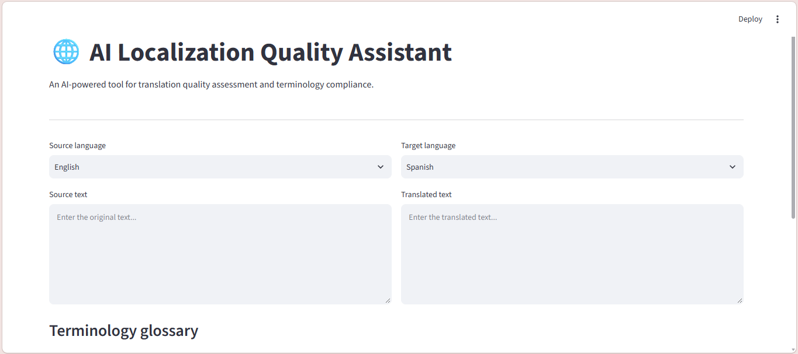
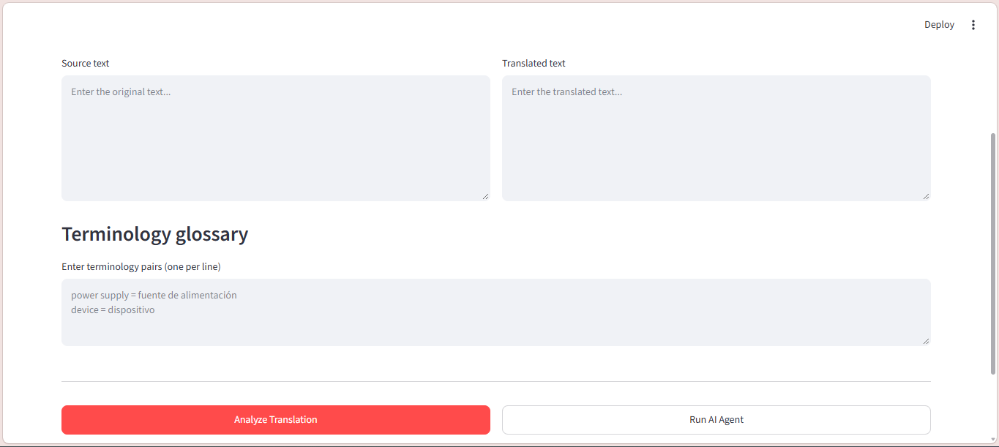
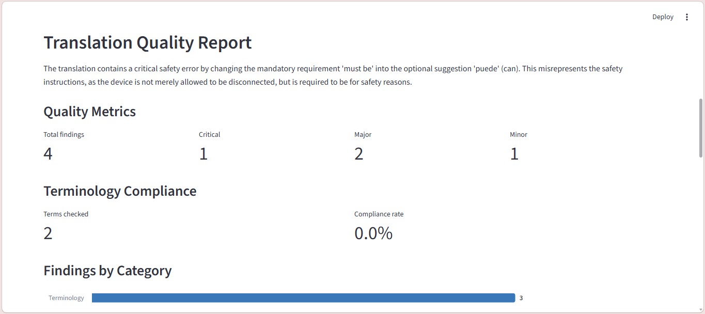
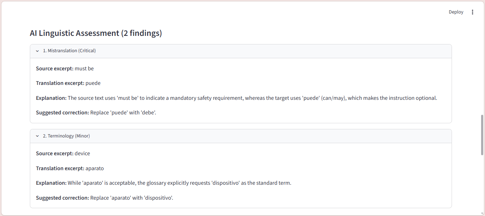
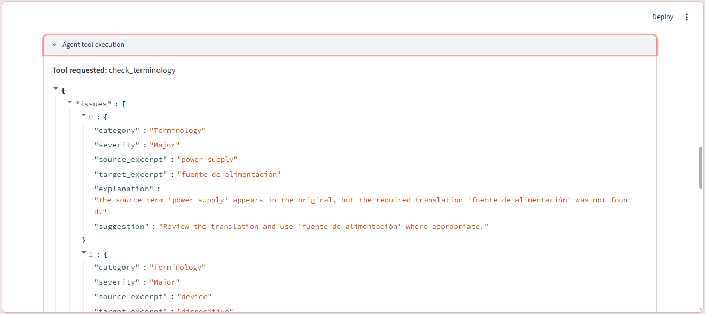
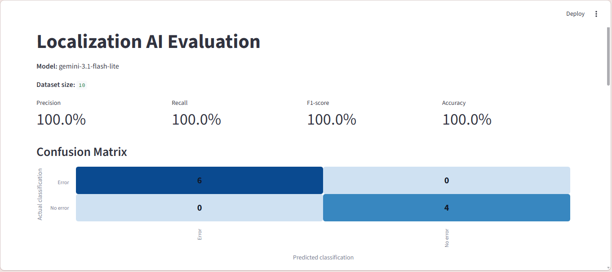

# AI Localization Quality Assistant

**AI-powered translation quality assessment and terminology validation using Google Gemini, Python and Streamlit.**

AI Localization Quality Assistant is a Python application designed to support localization quality assurance workflows by combining generative AI analysis with deterministic terminology checks.

The application evaluates source and translated texts, identifies potential linguistic and terminology issues, generates structured quality reports, and demonstrates AI tool calling through a Gemini-powered terminology agent.


## Screenshots

### Main Interface




### Translation Quality Report




### Gemini Terminology Agent



### Evaluation Dashboard




## Features

### AI-Powered Translation Quality Assessment

- Detects potential mistranslations, omissions, additions, grammatical issues and terminology inconsistencies.
- Classifies findings by severity: Critical, Major or Minor.
- Provides explanations and suggested corrections.
- Generates an overall translation quality assessment.

### Rule-Based Terminology Validation

- Accepts user-defined bilingual glossaries.
- Checks whether required translations appear in the target text when corresponding source terms are present.
- Calculates terminology compliance metrics.
- Reports missing required terms and invalid glossary entries.
- Operates independently of the AI model.

### Gemini Terminology Agent

Implements a tool-calling workflow using the Google Gen AI SDK.

1. Gemini receives a terminology review request.
2. The model requests the `check_terminology` function.
3. Python executes the terminology checker locally.
4. The tool results are returned to Gemini.
5. Gemini produces a terminology assessment based on the tool output.

The application displays the tool execution results for transparency.

### Quality Reports

- Structured linguistic and terminology findings.
- Severity and terminology compliance metrics.
- Visual summaries of detected issues.
- Separate sections for AI-generated and rule-based findings.
- JSON and CSV report exports.

Findings from different components may overlap and are not automatically deduplicated.

### Automated Testing and Evaluation

- Automated Python tests using pytest.
- A manually labeled evaluation dataset.
- Example-level classification metrics.
- A separate Streamlit evaluation dashboard.
- A confusion matrix for reviewing classification results.

## Technology Stack

| Technology | Purpose |
|---|---|
| Python | Application logic and terminology validation |
| Streamlit | Interactive user interface |
| Google Gemini | AI-powered linguistic assessment and terminology agent |
| Google Gen AI SDK | Gemini API integration and function calling |
| Pydantic | Structured output validation |
| Pandas and Altair | Data processing and visualization |
| pytest | Automated testing |

## Architecture

The application provides two review workflows.

**Full Translation Analysis**

Source and target texts → Gemini linguistic analysis → Python terminology validation → Unified quality report → JSON/CSV export

**AI Terminology Agent**

Review request → Gemini function call → Python terminology checker → Tool response → Gemini assessment → Terminology report

The architecture combines probabilistic AI analysis with deterministic rule-based validation.

## Evaluation Results

The Gemini linguistic assessment was evaluated using a small, manually labeled dataset containing 10 English-to-Spanish technical translation examples.

Six examples contained deliberately introduced translation errors, while four were labeled as correct.

**Model:** `gemini-3.1-flash-lite`

| Metric | Result |
|---|---|
| Precision | 100% |
| Recall | 100% |
| F1-score | 100% |
| Accuracy | 100% |
| True Positives | 6 |
| True Negatives | 4 |
| False Positives | 0 |
| False Negatives | 0 |
| Successfully evaluated | 10 |
| Failed API requests | 0 |

These metrics describe one evaluation run on the provided dataset.

**Evaluation limitations:** The dataset is small and synthetic. Classification is performed at the example level: an example is considered positive when the model reports at least one issue. The evaluation does not establish whether every individual error was correctly identified or classified by severity. These results should not be interpreted as production-level accuracy.

The evaluation dataset, script and recorded results are available in the `evaluation/` directory.

## Installation

### Prerequisites

- Python 3.10 or later
- A Google Gemini API key
- Internet access for Gemini-powered features

### 1. Clone the repository

```bash
git clone https://github.com/YOUR_USERNAME/AI-Localization-Quality-Assistant.git
cd AI-Localization-Quality-Assistant
```

Replace `YOUR_USERNAME` with the GitHub account hosting the repository.

### 2. Create a virtual environment

```bash
python -m venv .venv
```

Activate it on Windows PowerShell:

```powershell
.\.venv\Scripts\Activate.ps1
```

On macOS or Linux:

```bash
source .venv/bin/activate
```

### 3. Install dependencies

```bash
python -m pip install -r requirements.txt
```

### 4. Configure the Gemini API key

Create a directory named `.streamlit` in the project root.

Inside it, create a file named `secrets.toml`:

```toml
GEMINI_API_KEY = "YOUR_GEMINI_API_KEY"
```

Do not commit this file to Git. It is excluded by `.gitignore`.

### 5. Run the application

```bash
python -m streamlit run app.py
```

Open the local URL displayed in the terminal.

## Running Tests

Run the automated Python tests:

```bash
python -m pytest tests -v
```

## Running the AI Evaluation

Execute the evaluation dataset against Gemini:

```bash
python evaluation/run_evaluation.py
```

This makes real Gemini API requests and may consume API quota or incur charges.

To view the recorded evaluation results:

```bash
python -m streamlit run evaluation/show_results.py
```

## Limitations

- AI-generated findings can vary between executions.
- Gemini may produce false positives, miss errors or assign inconsistent severity levels.
- The terminology checker uses exact matching and does not fully account for inflection, synonyms or contextual equivalence.
- AI and rule-based findings may overlap.
- The terminology agent does not perform the complete linguistic assessment.
- Human review remains necessary, particularly for safety-critical and regulated content.

## Future Improvements

- Terminology lookup tools with contextual matching.
- Additional agent tools for numerical, formatting and placeholder validation.
- More comprehensive evaluation datasets.
- Duplicate finding detection.
- Support for localization file formats.
- Improved evaluation of issue categories and severity.

## Project Purpose

This project was developed as a practical exploration of AI-assisted localization quality assurance, combining language technology, Python development, structured validation, AI tool calling and software evaluation.

It is a portfolio and educational project, not a certified translation quality assurance system.